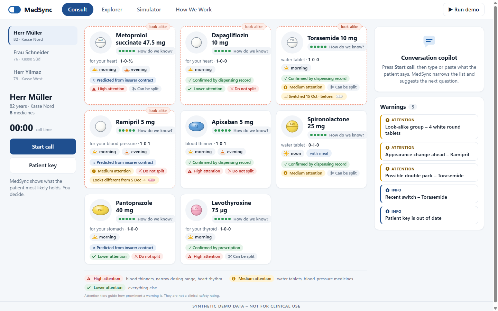
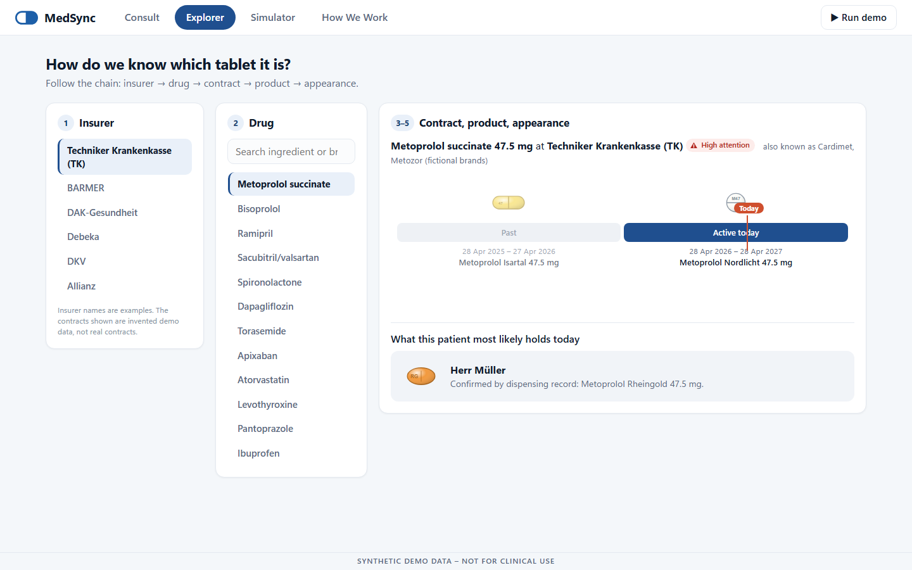
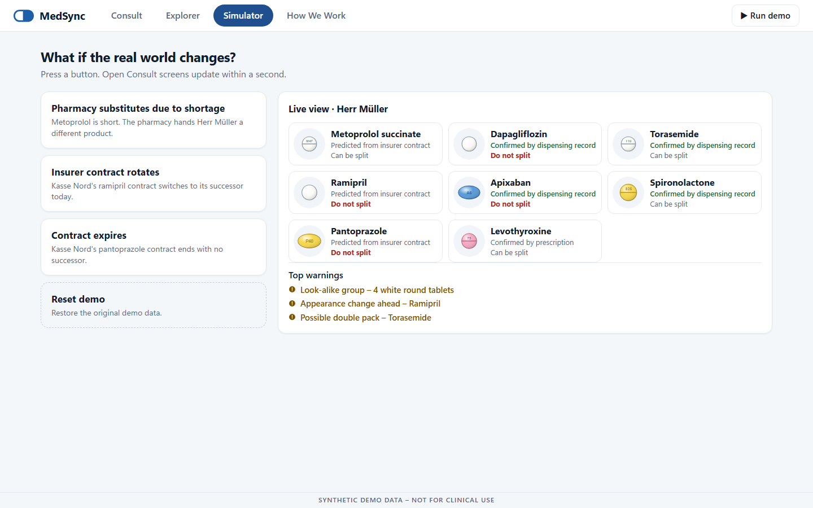
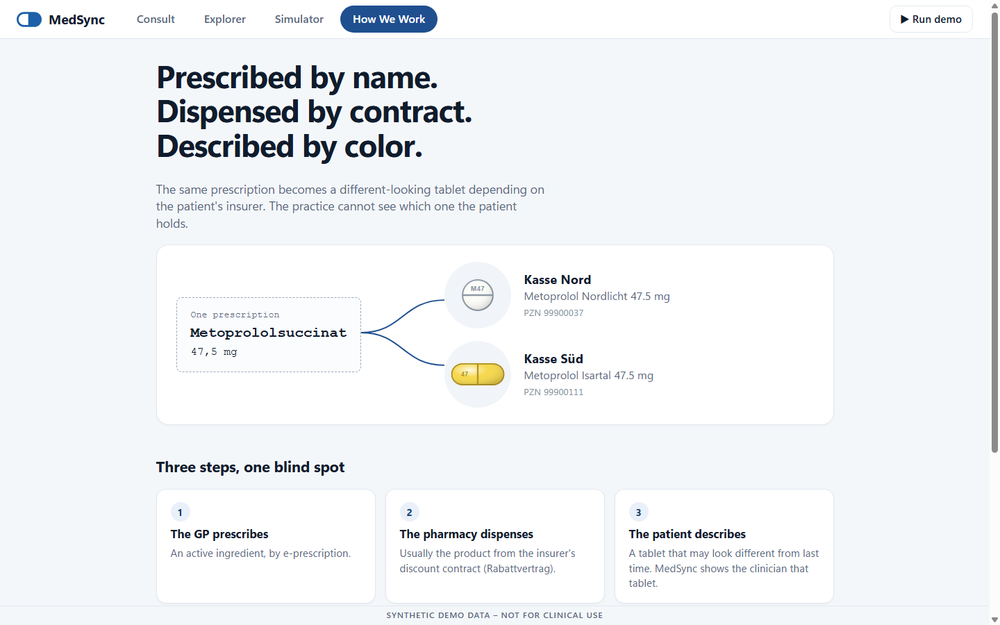
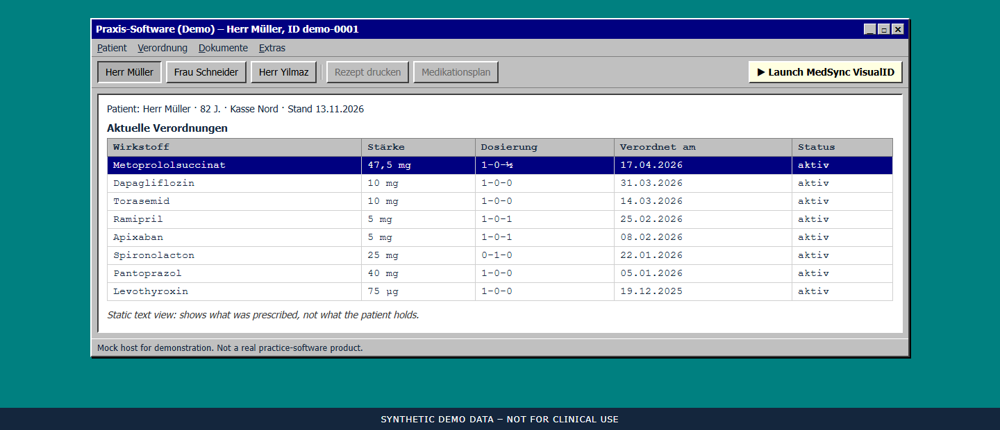
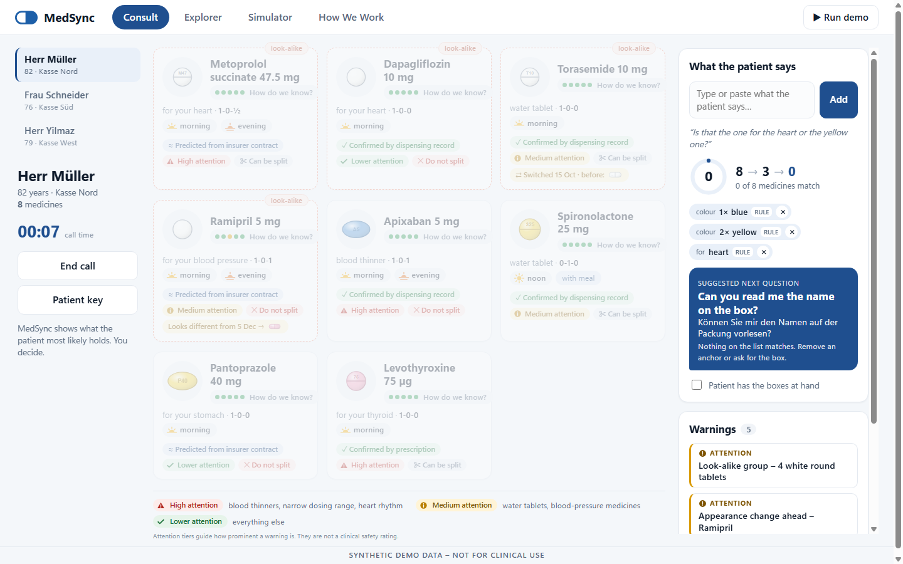
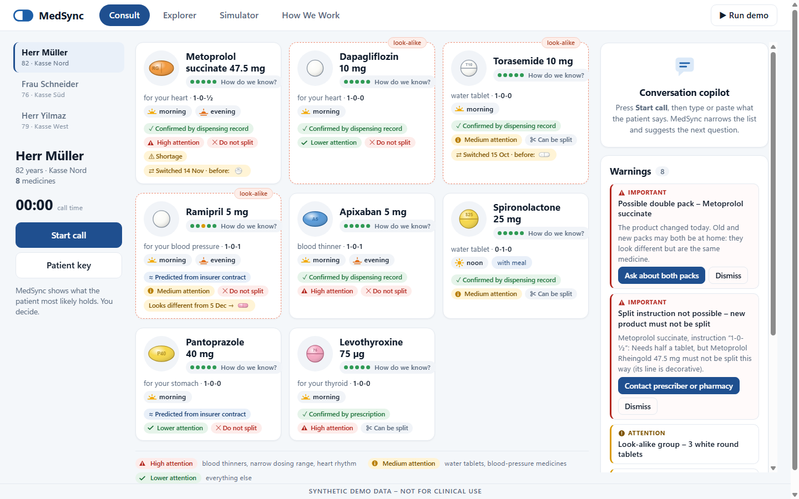

# MedSync

**See what the patient sees.** A communication and identification aid for clinicians on the phone with
heart-failure patients who take many medicines.

The patient says "three white tablets, one blue and two yellow ones". The clinician thinks in active
ingredients. MedSync bridges the two: it works out which product the patient most likely holds, shows it
as a large pill picture, narrows the list while the patient talks, and prints a large-print picture key.

> SYNTHETIC DEMO DATA – NOT FOR CLINICAL USE. Every contract, manufacturer, brand name and PZN is fictional.
> MedSync is not a dosing tool. The software proposes, the human decides.

Built for the Healthcare Hackathon Bayern (Erlangen), Challenge 1: medication adjustment with polypharmacy patients.

## Start it

You need Python 3.11 or newer. This machine has no `make`, so the commands live in `run.py`.

```bash
python run.py setup
```

```bash
python run.py run
```

Then open http://localhost:8000. It runs fully offline.

| Command | What it does |
|---|---|
| `python run.py setup` | Creates `.venv`, installs dependencies, loads the demo data |
| `python run.py run` | Starts the app on port 8000 |
| `python run.py test` | Runs the test suite (94 tests, about 20 seconds, no network) |
| `python run.py demo` | Resets the data, starts the app and plays the scripted demo |
| `python run.py reset` | Restores the demo data |

If you do have `make`, the same names apply: `setup`, `run`, `test`, `demo`, `reset` map one to one.

## Run the demo

Press **Run demo** (top right) or start with `python run.py demo`. A narrator bar plays six steps on
Herr Müller in under two minutes, with Pause, Next and Back. It works offline with the AI flag off.

1. Eight medicines as pictures; the white look-alike group is outlined.
2. "Ich nehme drei weiße Tabletten, eine blaue und zwei gelbe." Anchors appear, the list narrows.
3. "Is that the one for the heart or the yellow one?" Two remain; MedSync suggests asking about the score line. The nurse clicks "Confirmed with patient".
4. The plain-language trail: insurer, drug, contract, product, appearance.
5. Simulator: the pharmacy substitutes. The picture changes, and two warnings appear.
6. The patient key with the "What is new" box.

Every start of the app begins from the same demo data. **Reset demo** on the Simulator tab does the same.

## The tabs

| Consult | Explorer |
|---|---|
|  |  |
| **Simulator** | **How We Work** |
|  |  |

The Explorer lists six well-known insurers by name as examples. The contracts shown for them are invented
demo data. Everywhere else the app uses the fictional "Kasse Nord" and so on.

The mock practice software MedSync would open from is at http://localhost:8000/host (generic, labelled as a
mock, nothing is integrated).



Narrowing during a call, and the screen after a pharmacy substitution:




## How it is built

Layers call downwards only. No layer imports from the UI.

| Layer | Package | Job |
|---|---|---|
| 1 | `app/l1_data` | Tables, seed, generated pill pictures, the four adapters |
| 2 | `app/l2_classify` | One vocabulary: chain levels, colours, shapes, purposes, synonyms (DE/EN) |
| 3 | `app/l3_resolve` | The five-stage chain: insurer → drug → contract → product → appearance |
| 4 | `app/l4_insight` | Look-alike groups, warning rules R1–R8, clinician actions, audit trail |
| 5 | `app/l5_conversation` | Anchors from what the patient says, narrowing, best next question |
| 6 | `app/l6_outputs` | Patient key (PDF and text), FHIR-shaped export |
| 7 | `app/l7_api` | Thin FastAPI routes: typed JSON or HTMX partials |
| 8 | `app/l8_ui` | Jinja2 templates, hand-written CSS, HTMX (served locally) |
| – | `app/demo` | Simulator actions and the scripted scenario |

Stack: Python, FastAPI, SQLModel on SQLite, Pydantic v2, Jinja2, HTMX, ReportLab, pytest.
API documentation is at http://localhost:8000/docs while the app runs.

## Optional: the AI extractor (Claude on Amazon Bedrock)

Off by default. The rule-based parser handles German and English on its own.

**Turning it on sends de-identified transcript text to AWS.** Names, dates of birth, addresses and phone
numbers are removed first, using the patient record and pattern matching. De-identification of free text
can miss things, so do not use it with real patient data without a data protection assessment.

1. Install the AWS SDK: `.venv/Scripts/python -m pip install boto3` (on macOS/Linux: `.venv/bin/python`).
2. Copy `.env.example` to `.env` and set:

   ```
   USE_LLM_EXTRACTOR=true
   AWS_REGION=eu-central-1
   BEDROCK_MODEL_ID=<a Claude model or EU inference profile enabled for your account>
   ```

3. Provide AWS credentials the usual way (environment variables or an AWS profile).

The model must be available in an EU region for your account; check the Bedrock console for the exact
model or inference profile ID. The call has a 3-second timeout. On any error, timeout or invalid reply
MedSync falls back to the rule-based parser and logs the fallback. Anchors from the model are validated
against the vocabulary and marked "AI" in the UI; rule-based ones are marked "rule".

## More

- `docs/PITCH.md` – the 3-minute script
- `docs/JUDGE_QA.md` – answers to likely jury questions
- `docs/JURY_MAP.md` – the five jury criteria mapped to features
- `docs/LIMITATIONS.md` – what is simulated and what production needs
- `docs/ASSUMPTIONS.md` – choices made where the specification was silent
